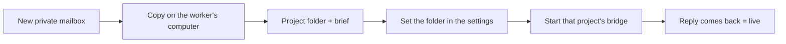

# User Manual — Hundred Dollar Round Table

## 1. What this is

This kit lets you chair a meeting between AI agents that live in different places — one on your phone or in the cloud, one on your computer. Instead of copying messages from one agent and pasting them into the other, the agents write to each other through a shared mailbox. You sit in the chair. You watch everything, you can join in at any time, and no real work happens without your say-so.

## 2. The picture

Here is how one message travels:

1. The chair side writes a numbered message — #1, #2, #3 — and puts it in the mailbox.
2. A small program called the bridge runs on the worker's computer. It checks the mailbox every few seconds.
3. When a new message appears, the bridge wakes the worker agent up, inside its project folder, and hands it the message.
4. The worker thinks, does its turn, and writes a reply.
5. The bridge puts the reply back in the mailbox, where the chair side reads it.

That is the whole machine. Everything is a written file, so you always have a full record of the meeting afterwards.

## 3. What you need

- **A computer that stays on during meetings.** The worker lives there. If it sleeps or switches off, the meeting pauses.
- **Python** — the free programming tool the bridge is written in. Version 3.10 or newer.
- **Git** — the free tool that moves the mailbox files back and forth and keeps their history.
- **The agent programs, installed and signed in** on that computer — for example Claude Code, and Antigravity (`agy`) if you want a Gemini seat. A seat is one worker's place in the meeting.
- **Two repositories** (a repository is an online folder for files, kept on GitHub):
  - The **public template** — the kit itself. It holds no private data. Anyone may copy it.
  - **Your own private mailbox** — a private copy of the template where your meetings actually happen. Your conversations live there, so it must stay private.

## 4. Set it up

About ten minutes, once:

1. On GitHub, use the template to create a new repository. Set it to **Private**. Then download it (clone it) onto the computer that will run the bridge.
2. In the `bridge` folder, copy `bridge.config.example.json` and rename the copy to `bridge.config.json`.
3. Open `bridge.config.json` and set `project_dir` — the folder the worker should work in. Leave `mailbox_dir` as `..`.
4. Give your chair agent access to the same private repository, so it can write messages and read replies.
5. Start the bridge: double-click `start-meeting.bat` on Windows, or run `./start-meeting.sh` on Mac or Linux. Leave that window open while you meet.

## 5. Run a meeting, day to day

- **Send a message.** Either ask your chair agent to send it, or run the helper yourself: `python tools/send_message.py "Your message here"`. The helper gives it the next number and delivers it.
- **Read the replies.** They land in the `out/` folder, one file per message, named by number.
- **See what is happening.** The `status.json` file says it plainly: *idle* (nothing going on), *agent-working* (a worker is on a turn right now), *done*, or *error*.
- **One turn at a time.** Messages are handled in number order. A new message waits until the current turn finishes. That is normal meeting behaviour — nobody talks over anyone else.
- **Talking between workers.** Workers do not see each other's replies on their own. The chair side passes the words along, pasting the important part into the next message.

## 6. Talk to the worker you mean

A meeting can hold more than one worker. Each worker is a **seat**, listed in the `agents` part of `bridge.config.json`.

- To choose who gets a message, start it with a **To: line** — for example `To: gemini`. With the helper tool, that is `python tools/send_message.py --to gemini "Your message here"`. No To: line means the message goes to the default worker.
- **Seats are workers in the same meeting.** A seat can name its own `project_dir`, so the workers in one meeting can sit in different folders if needed — each with its own conversation. Projects are not separated by seats: each *project* gets its own mailbox and its own bridge (see "Adding another project" below).
- **Each project needs a short brief.** Put a file called `PROJECT-CONTEXT.md` in the project folder. It tells the worker what the project is, the standing rules, where things stand, and what must not break. A blank template for it is included in the kit (`templates/project-context-template.md`). On a worker's first turn, the bridge points the worker at that file automatically, before anything else.

## Adding another project (when one is already running)

Good news first: each project gets its own mailbox and its own bridge — so meetings never wait for each other, and two meetings can run at the same time. The projects already running are not touched at all.



Think of it as one table per project, each with its own bridge. The bridges run side by side:

```
    Bridge 1: first project  - its own mailbox, its meeting is running
    Bridge 2: second project - its own mailbox, its meeting is running at the same time
    Bridge 3: not set up yet - waiting for the next project
```

Here are the six steps:

1. **Make a new private mailbox for the project.** On GitHub, use the kit template to create a new repository for this project, and set it to **Private**.
2. **Put a copy of it on the worker's computer.** Download it (clone it) into its own folder on that computer. Each project's copy lives in its own folder.
3. **Get the project folder onto the same computer, and put a brief in it.** Copy or download the project itself, then copy the kit's blank template into its folder, name it `PROJECT-CONTEXT.md`, and fill it in — so the new worker starts out knowing the project.
4. **Set the project folder in the new copy's settings.** In the new copy's `bridge` folder, open `bridge.config.json` and set `project_dir` to the project folder.
5. **Start that project's bridge.** Double-click its `start-meeting.bat` (or run `./start-meeting.sh`). Each project has its own bridge window — you can run several bridges at once, side by side.
6. **Send a test hello from that project's meeting chat.** When the reply comes back, the project is live — running on its own, at the same time as the others. For the next project after that, just repeat these same six steps.

One last thing: each project also gets its own meeting chat — and its own room, if you use the visual room. One project, one chat, so meetings never get mixed up.

## 7. The rules that keep it safe

- **Talking is free.** Questions, discussion, and read-only checks need no permission.
- **Work needs your go-ahead.** Before a worker is told to change, build, send, publish, buy, or delete anything, you must approve it — either message by message, or by agreeing the scope at the start of the meeting.
- **No message ever runs twice.** The bridge writes down that a number has started *before* the worker runs. If anything crashes mid-turn, that number gets an error reply instead of a silent second run.
- **Keep the mailbox private.** Your meetings, your files, and your real config file all live there.

## 8. If something goes wrong

- **"Another bridge is already running."** You may have left the bridge window open — close it first. If the old bridge crashed, its lock file can be left behind; the bridge checks whether the old one is truly gone and clears a stale lock by itself.
- **The meeting stalls and no reply comes.** Check the bridge window is still open on the worker's computer. The mailbox also heals itself: if the two sides' copies drift apart, the bridge lines them up again on its own.
- **The worker's computer keeps asking for permission.** The worker's program asks the human before running commands. Those prompts can only be answered by a person at that computer. The fix is to allow that project's own commands in the worker's settings, so the meeting stops being interrupted.
- **Replies contain garbled text** — strange characters where accents or dashes should be. That was a bug, fixed in version 0.3.3. Update the kit and restart the bridge.
- **A turn fails.** You get an error reply file in `out/` saying what happened. Nothing is hidden, and nothing is retried behind your back.

## 9. What it cannot do

- **It cannot read a live session's mind.** If you have a chat already open with a worker somewhere else, the meeting worker cannot see it. Knowledge moves only through files — that is what the `PROJECT-CONTEXT.md` brief is for.
- **It is turn-by-turn, not live.** There is a natural pause while each worker takes its turn. You cannot cut a worker off mid-sentence; a stop takes effect when the current turn ends.
- **The computer must be on.** No bridge running means no meeting. Messages simply wait in the mailbox until it starts again.
